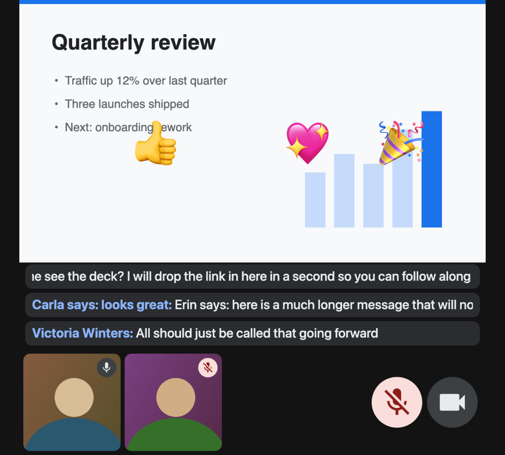
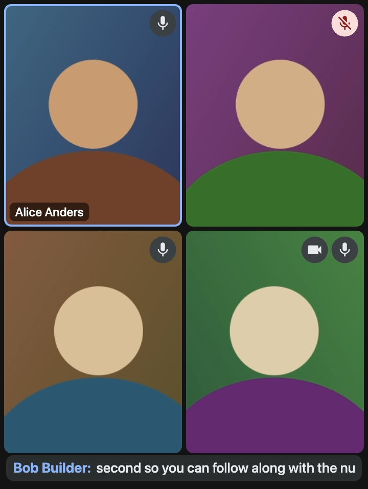
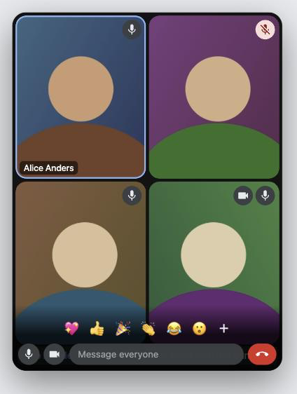

#  Meet PiP for Firefox

Picture-in-picture for Google Meet in Firefox and Firefox-based browsers (Zen).
Shows the presentation, participant video, chat, reactions and your mic/camera
state in an always-on-top window, and opens when you leave the tab. An optional
mod for Zen adds mic, camera, reaction, chat and end-call buttons to that
window.

| Presenting | Not presenting |
| --- | --- |
|  |  |

Screenshots are from the test page, not a real call.

## How it works

Firefox has no Document Picture-in-Picture API. The extension draws Meet's
video tiles onto a canvas, streams the canvas into one `<video>`, and lets
Firefox's built-in PiP show that video.

- Presenting: the shared screen at full width, with participant tiles and
  your own tile in a row under it. 1280 px wide; height follows the
  slide's aspect ratio.
- Not presenting: a grid of equal, centre-cropped 4:5 tiles, 720 px wide. The
  window's shape follows the number of tiles. Past 6
  participants the last tile reads "+N more".
- New chat messages show for 10 seconds, one line each. The sender stays in
  place and a long message scrolls past twice.
  Reactions float up over the video.
- Each participant tile has a mic badge showing whether they are muted. Your
  own tile is always last, with your mic and camera state on it.
- Meet's raise-hand gesture shows on your tile: a ring fills in green while
  Meet counts, then a hand stays in the corner while your hand is up.
- Whoever spoke last always has a tile, with their name on it and an outline
  while they talk, even with their camera off.
- Meet is not told that PiP is open or that its tab is hidden, so it keeps the
  layout you left.
- The PiP window's mute button toggles Meet's microphone, and its pause
  button turns Meet's camera off. The [Sine mod](#sine-mod-optional) replaces
  both with a fuller set of controls.

A button in Meet's bottom bar, left of the controls, opens and closes the PiP
window.

## Install

Download `meet-pip.xpi` from the
[latest release](https://github.com/AnalogAyub/meet-pip-firefox/releases/latest)
and open it in Firefox or Zen. It is signed by Mozilla, so no settings need
changing.

## Sine mod (optional)

Firefox's PiP window only has play and mute buttons. `sine-mod/` is a
[Sine](https://github.com/CosmoCreeper/Sine) mod for Zen that replaces them,
for Meet calls only, with a bar that appears when you hover over the window.
Other PiP windows are left alone.

| Control | What it does |
| --- | --- |
| Mic | Mutes and unmutes. Turns pink when muted. |
| Camera | Turns the camera off and on. Turns pink when off. |
| 💖 👍 🎉 👏 😂 😮 | Sends that reaction. |
| ＋ | Opens the macOS emoji picker; whatever you pick is sent as a reaction. An emoji outside Meet's quick set is found in Meet's own picker. |
| Message everyone | Sends a chat message on Enter. Opens Meet's chat panel if it has to, and closes it again. |
| End call | Leaves the call and closes the Meet tab. One click, no confirmation. |

With the mod, the extension also matches its tile corners to the PiP window's.

Turning the camera on needs a detour. Firefox applies a saved camera permission
only while the Meet tab is selected and its window is the active one, which is
never the case while you are clicking in the PiP. So the mod brings the Meet
tab forward, waits for the grant, and returns to the tab you were on. It takes
a fraction of a second.

### Installing it

1. Install [Sine](https://github.com/CosmoCreeper/Sine) in the profile you
   take calls in.
2. Set `sine.allow-unsafe-js` to `true` in `about:config`. Sine will not run a
   mod's JavaScript without it.
3. In Sine's settings, add a mod from a repository:
   `AnalogAyub/meet-pip-firefox/tree/main/sine-mod`.
4. Install the extension in the same profile. The mod only draws the buttons;
   the extension carries out what they ask in the Meet tab.

The ＋ button's picker is macOS only. Finding the chat box, and the reaction
bar when it is closed, relies on Meet's English labels.

## Settings

In `about:config`:

| Pref | Value | Effect |
| --- | --- | --- |
| `media.videocontrols.picture-in-picture.enable-when-switching-tabs.enabled` | `true` | Open PiP when you leave the Meet tab, close it when you return |
| `media.videocontrols.picture-in-picture.enable-when-occluded.enabled` | `true` | Also open when another window covers the browser (optional) |
| `dom.media-pip.enabled` | `true` | Needed for the toolbar button; otherwise use ⌘⇧] |

Extension options are in the `CONFIG` object at the top of `content.js`.

## Limitations

- Depends on Meet's DOM, which changes. The selectors are in the `MEET` object,
  `tileInfo()`, `scanChat()` and the `MutationObserver` in `content.js`.
- Chat is read from the chat panel once it has been opened, and from Meet's
  `aria-live` announcements otherwise.
- Without the Sine mod, the camera can be turned off from PiP but not on.
  Firefox withholds camera grants from tabs that are not selected.
- Firefox does not tell a page when PiP is opened with ⌘⇧] or the hover
  toggle. A PiP opened that way updates at 3 fps while the Meet tab has focus.
- Only the last speaker's tile shows a name.
- Who is speaking, and who is muted, are read from Meet's tile markup: class
  changes on the voice indicator, and the icon on each tile's mute button.

## Testing

Serve the repo root and open:

- `test/mock-meet.html`, a fake call. `?present` adds a screenshare, `?n=9`
  more participants, `?speaker=2` someone talking, `?hand` the raise-hand
  gesture. `window.sim()` in the console sends chat and reactions.
- `test/mock-pip.html`, a stand-in for the PiP window with the Sine mod's bar
  over that fake call, for checking the bar's styling without Zen.

## License

Public domain ([Unlicense](LICENSE)). Copy, modify, remix, sell or
redistribute it however you like. No attribution needed.
