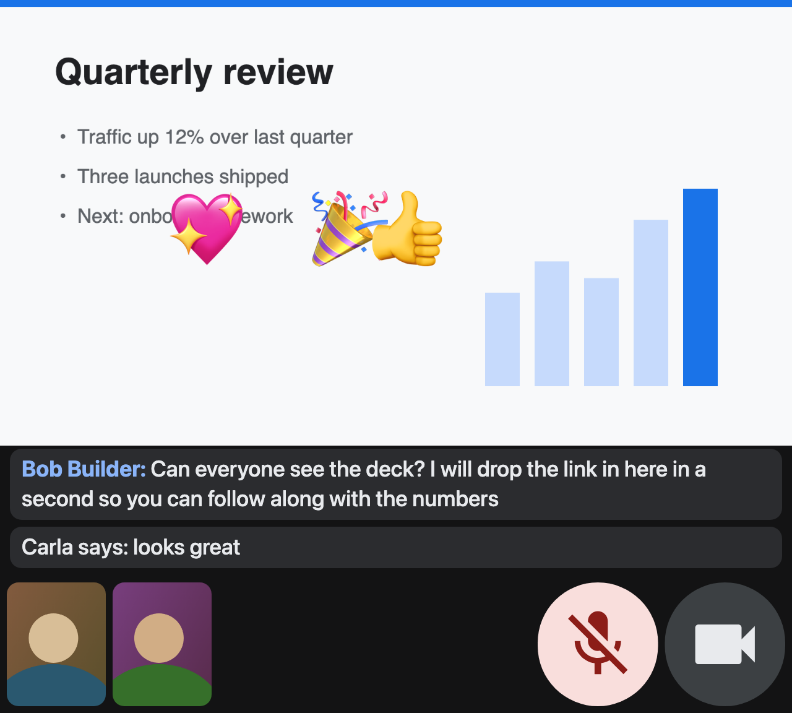
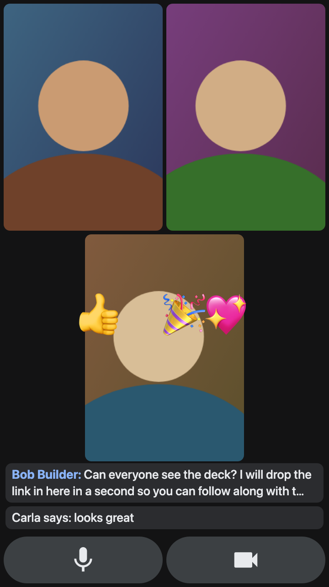

# Meet PiP for Firefox

Picture-in-picture for Google Meet in Firefox and Firefox-based browsers (Zen).
Shows the presentation, participant video, chat, reactions and your mic/camera
state in an always-on-top window, and opens when you leave the tab.

| Presenting | Not presenting |
| --- | --- |
|  |  |

Screenshots are from the test page, not a real call.

## How it works

Firefox has no Document Picture-in-Picture API. The extension draws Meet's
video tiles onto a canvas, streams the canvas into one `<video>`, and lets
Firefox's built-in PiP show that video.

- Presenting: the shared screen at full width, with participant tiles and
  mic/camera indicators in a row under it. 1280 px wide; height follows the
  slide's aspect ratio.
- Not presenting: a 720x1280 grid of up to 6 participants, centre-cropped.
- Recent chat messages and reactions are drawn in both layouts.
- The PiP window's mute button toggles Meet's microphone.
- The PiP window's pause button turns Meet's camera off.

A button in Meet's bottom bar, left of the controls, opens a preview with a
**Pop out** button.

## Install

Temporary: `about:debugging` → This Firefox → Load Temporary Add-on →
`manifest.json`.

Development:

```bash
npx web-ext run --source-dir . --firefox "/Applications/Zen Browser.app/Contents/MacOS/zen"
```

Permanent: sign it with `npx web-ext sign --channel unlisted`, or set
`xpinstall.signatures.required` to `false` in `about:config` if your build
allows it, then install the zipped folder as an `.xpi`.

## Settings

In `about:config`:

| Pref | Value | Effect |
| --- | --- | --- |
| `media.videocontrols.picture-in-picture.enable-when-switching-tabs.enabled` | `true` | Open PiP when you leave the Meet tab, close it when you return |
| `media.videocontrols.picture-in-picture.enable-when-occluded.enabled` | `true` | Also open when another window covers the browser (optional) |
| `dom.media-pip.enabled` | `true` | Needed for the **Pop out** button; otherwise use ⌘⇧] |

Extension options are in the `CONFIG` object at the top of `content.js`.

## Limitations

- Depends on Meet's DOM, which changes. The selectors are in the `MEET` object,
  `tileInfo()`, `scanChat()` and the `MutationObserver` in `content.js`.
- Chat is read from the chat panel once it has been opened, and from Meet's
  `aria-live` announcements otherwise.
- The camera can be turned off from PiP but not on. Firefox withholds camera
  grants from tabs that are not selected.
- Firefox does not tell a page when PiP is opened with ⌘⇧] or the hover
  toggle. A PiP opened that way updates at 3 fps while the Meet tab has focus.
- No participant names or active-speaker highlight.

## Testing

`test/mock-meet.html` fakes a call. Serve the repo root and open it; add
`?present` for a screenshare.

## License

Public domain ([Unlicense](LICENSE)). Copy, modify, remix, sell or
redistribute it however you like. No attribution needed.
